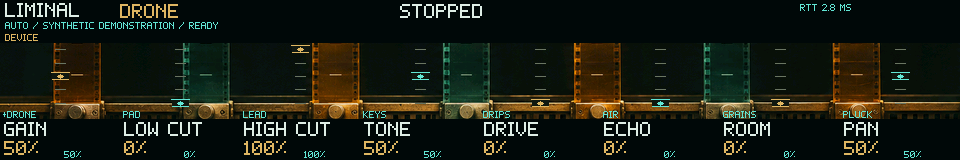

# Liminal Controller

A standalone Push 3 surface for a running [Liminal](https://github.com/pj4533/Liminal)
instance. Full-screen original cinematic material, eight live remote controls,
channel mixer, manual scale pads, prepared drum choices and live chop banks.
Python 3.10+, standard library at runtime. No audio is generated on Push.



The controller opens one persistent outbound TCP connection to Liminal on your
trusted LAN, normally port 20808. It boots safely disconnected and displays
WAITING FOR LIMINAL. Play requests the normal Liminal video/readiness gate.
All values, modes, instrument identities and pad readiness come from Liminal;
reconnect never restores an old mix or replays a note.

## Try without hardware

```sh
python3 -m unittest discover -s tests -v
python3 scripts/demo.py --screenshot .build/demo.ppm
```

The demo runs the actual `src/app.py --simulate` entry point and a deterministic
local synthetic peer. It produces a native-size PPM without USB, MIDI or audio.
For interactive protocol experiments, run `python3 src/fake_server.py --ambient`
and `python3 src/app.py --simulate --seconds 10 --screenshot .build/frame.ppm`
in separate terminals. The simulator is intentionally headless; automated tests
exercise the real MIDI parser and Controller.event handler.

**Status (2026-11-20):** implementation and repairs are pushed. Controller
`c5917418` was installed and verified running before a controlled reboot:
exclusive controller ownership, advancing USB display transfers and disconnected
readiness were observed; the existing session and 104 recordings were preserved,
and return to Stillwater was exercised. After reboot, strict SSH rejected a
changed host key. No replacement key was accepted; post-reboot identity and
operation are **unknown**. Latest documentation/bundle revisions have not been
deployed over that lost trust.

The paired Liminal source is `push3` commit `378174bd`. Native Mac builds/tests,
visionOS compilation and connected audio/playability remain unverified; the
pre-reboot controller was disconnected from Liminal. Lo-Fi bass/lead/mids remain
disabled pending isolated-wet measurements; Film and Space manual pads are
unavailable. Network RTT is never represented as pad-to-audio latency. See the
[host coding-session handoff](docs/MAC_NATIVE_HANDOFF.md) for native work and
trusted device identity recovery. The full playable-project objective is open.

Read [installation/recovery](docs/INSTALL.md), [controls](docs/CONTROLS.md),
[architecture](docs/ARCHITECTURE.md), [protocol](docs/protocol-v1.md),
[validation](docs/VALIDATION.md), and [artwork provenance](docs/ARTWORK.md).
MIT; retained upstream notices in NOTICE and LICENSE.push-hack.
